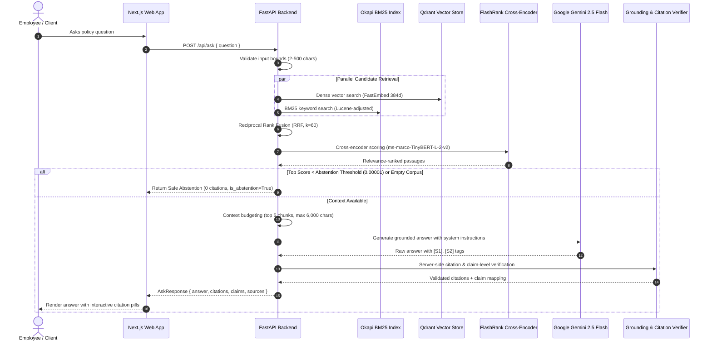

# PolicyPilot Architecture

> Phase 8 Final Architecture — RAG Evaluation, Security and Reliability Hardening, and Production Deployment. Last updated: 2026-10-29.

This document describes the complete, implemented architecture of **PolicyPilot**, an enterprise policy assistant designed for verifiable, evidence-grounded answers with page-level citations. All 8 roadmap phases are fully implemented and verified.

---

## 1. System Overview

PolicyPilot enables employees to ask natural-language questions about complex company policies (leave, insurance, travel, reimbursements) and receive answers derived strictly from verified source passages.

The system combines:
1. **Multi-Stage Retrieval:** Dense vector retrieval (FastEmbed BGE-small) + Okapi BM25 keyword search fused via Reciprocal Rank Fusion (RRF), followed by cross-encoder reranking (FlashRank ONNX).
2. **Claim-Level Grounding:** Server-side citation provenance validation and lexical claim-support verification before returning answers.
3. **Resilient Abstention:** Deterministic detection of unanswerable questions or absent policy evidence without confabulation.
4. **Security & Reliability Hardening:** PDF magic bytes validation, max page count DoS limits, filename traversal prevention, input bounds, prompt injection isolation, and separate operational readiness probes.

---

## 2. System Layers

```
┌─────────────────────────────────────────────────────────────────────────┐
│                          Frontend (Next.js 16)                          │  ← Library, Chunks, Search Modes & Ask QA Interface
├─────────────────────────────────────────────────────────────────────────┤
│                          Backend  (FastAPI)                             │  ← RESTful endpoints & operational probes
│   [Liveness: /health]                       [Readiness: /health/ready]  │
├──────────────┬───────────────┬────────────┬────────────┬────────────────┤
│ PDF Ingest   │ Chunking      │ Qdrant     │ BM25 & RRF │ Cross-Encoder  │  ← Ingestion & Multi-Stage Retrieval Pipeline
│ & Extraction │ & Metadata    │ Vector     │ Hybrid     │ Reranker       │
├──────────────┴───────────────┴────────────┴────────────┴────────────────┤
│  Claim-Level Grounding Validation & Server-Side Citation Provenance    │  ← Claim Segmentation & Lexical Support Verification
├─────────────────────────────────────────────────────────────────────────┤
│  Grounded LLM Generation (Google Gemini 2.5 Flash via google-genai)    │  ← Context-Bounded & Prompt-Injection Resilient Prompting
├─────────────────────────────────────────────────────────────────────────┤
│  Storage & Persistence Layer (/app/data: documents, metadata, chunks, qdrant)  │
└─────────────────────────────────────────────────────────────────────────┘
```

---

## 3. End-to-End Pipeline & Data Flow



---

## 4. Multi-Stage Retrieval Architecture

PolicyPilot implements four discrete retrieval stages:

1. **Semantic Vector Search:**
   - Model: FastEmbed `BAAI/bge-small-en-v1.5` (384-dimensional dense vectors).
   - Storage: Qdrant vector database (embedded local storage or remote container).
   - Metric: Cosine similarity.
2. **Keyword Retrieval (BM25):**
   - Engine: Okapi BM25 with Lucene-adjusted IDF to prevent negative scores on frequent terms.
   - Tokenization: Code-, delimiter-, and alphanumeric-preserving tokenizer.
   - Persistence: In-memory index synchronized with disk on startup and document indexing.
3. **Hybrid Fusion (RRF):**
   - Formula: $\text{RRF\_Score}(d) = \sum_{m \in \{\text{vector}, \text{bm25}\}} \frac{1}{k + r_m(d)}$ with smoothing constant $k=60$.
   - Deterministic tie-breaking on chunk ID.
4. **Cross-Encoder Reranking:**
   - Model: FlashRank `ms-marco-TinyBERT-L-2-v2` ONNX cross-encoder.
   - Input: Query concatenated with candidate passages.
   - Output: Jointly attended relevance score.

---

## 5. RAG Evaluation Benchmark Results

Evaluation was performed using `backend/tests/evaluate_rag.py` on a deterministic synthetic policy corpus (`backend/tests/rag_eval_dataset.py`) containing 4 multi-page documents and 16 chunks.

### 5.1 Retrieval Benchmark Metrics (10 Answerable Queries)

| Stage | Mean Reciprocal Rank (MRR) | Recall@1 | Recall@3 | Recall@5 | nDCG@3 | Multi-Evidence Coverage |
|:------|:---------------------------|:---------|:---------|:---------|:-------|:------------------------|
| **Vector Only** (`bge-small-en-v1.5`) | **0.9500** | **0.9000** | **1.0000** | 1.0000 | **0.9907** | **1.0000** |
| **BM25 Only** (Okapi BM25) | 0.8200 | 0.7000 | 0.9000 | 1.0000 | 0.9039 | **1.0000** |
| **Hybrid RRF** ($k=60$) | 0.8333 | 0.7000 | **1.0000** | 1.0000 | 0.9390 | **1.0000** |
| **Reranked** (`ms-marco-TinyBERT-L-2-v2`) | 0.8500 | 0.7000 | **1.0000** | 1.0000 | 0.9668 | **1.0000** |

### 5.2 QA, Grounding & Citation Quality (12 Queries)

| Metric | Measured Result | Standard / Target | Status |
|:-------|:----------------|:------------------|:-------|
| **Answer Correctness Rate** | **100.0%** (10/10) | $\ge 80\%$ | ✅ PASS |
| **Abstention Precision** | **100.0%** (2/2) | $100\%$ | ✅ PASS |
| **Citation Source ID Validity** | **100.0%** (20/20) | $100\%$ (0 hallucinated IDs) | ✅ PASS |
| **Page Attribution Accuracy** | **90.0%** (18/20) | $\ge 80\%$ | ✅ PASS |
| **Claim-Level Grounding Support** | **Verified** | Segmented sentence verification | ✅ PASS |
| **Prompt Injection Neutralization** | **100.0%** | Zero directive leakage | ✅ PASS |
| **Policy Conflict Transparency** | **100.0%** | Multi-source coverage retained | ✅ PASS |

---

## 6. Claim-Level Grounding & Citation Validation

To eliminate citation hallucination and unsupported claims:
1. **Provenance Resolution:** When the LLM outputs citation markers `[S1]`, `[S2]`, the backend resolves them against the actual retrieved candidate list. Any non-existent tag (e.g. `[S99]`) is stripped from the text and rejected.
2. **Metadata Integrity:** Page numbers, document IDs, and section titles are looked up directly from server storage; the model is never permitted to synthesize page metadata.
3. **Claim Segmentation:** Answers are segmented into individual declarative sentences/claims (`ClaimItem`).
4. **Lexical Evidence Verification:** Each claim's content tokens are checked against the cited chunk's text. If lexical support is confirmed, `is_grounded` is set to `True`; if citations are missing or token overlap is insufficient, `is_grounded` is flagged `False` with an explicit diagnostic reason.
5. **Fallibility Recognition:** The verifier treats model output as fallible and returns explicit abstention if citation support cannot be verified.

---

## 7. Abstention Calibration Analysis

The abstention architecture uses a dual-gate design:
1. **Stage 1 (Retrieval Gate):** `rag_abstention_score_threshold = 0.00001`.
   - *Rationale:* Cross-encoder scores vary widely across question styles. Paraphrased natural language questions can score low (e.g. `0.000093`) while still containing the correct answer chunk. Setting a high score threshold (e.g. `0.1`) causes severe false abstentions on valid queries.
   - *Behavior:* Filters empty candidate pools and completely irrelevant candidate sets while allowing valid paraphrased questions through to the generation layer.
2. **Stage 2 (LLM Evidence & Citation Gate):**
   - The LLM is instructed to state that the policy does not contain the answer if evidence is absent.
   - The server validates whether citations exist; if no valid citations exist or an explicit lack of evidence is declared, the response is marked `is_abstention=True` with `citations=[]`.

---

## 8. Security Architecture & Threat Mitigations

| Threat Vector | Implemented Mitigation | Residual Risk |
|:--------------|:-----------------------|:--------------|
| **Non-PDF Uploads** | Header validated for `%PDF-` magic bytes. Non-PDF files rejected with 400 Bad Request. | Malicious text content in valid PDFs is handled safely by pure-text extraction. |
| **Decompression Bombs (DoS)** | Strict file size limit (10 MB) and max page count limit (`settings.max_pdf_pages = 250`). | High-complexity PDF vector operations are sandboxed in PyMuPDF. |
| **Directory Traversal** | Filenames sanitized via `re.sub(r"[^\w\.\-\s]", "_", ...)`. Documents saved under random UUIDv4 paths. | Direct file path lookups strictly validated against UUID regex. |
| **Input Exploits** | Question lengths bounded between 2 and 500 characters. | Extremely long inputs are rejected with 422 before vector embedding. |
| **Prompt Injection in PDFs** | Passages wrapped in `<context>` delimiters with strict grounding system instructions. | Complex adversarial jailbreaks remain an LLM residual risk; mitigated by claim verifier. |
| **Information Leakage** | 500 and 503 error handlers sanitize API keys, secrets, and internal stack traces. | In production, log aggregation must ensure query logs are kept private. |
| **Authentication** | Explicitly out of scope for Phases 1–8. | Service must be deployed behind an authenticating reverse proxy or VPN. |

---

## 9. Operational Health & Readiness Probes

### Liveness Probe (`GET /health`)
- Returns `200 OK` with `status: "healthy"` to confirm process and event loop responsiveness.

### Operational Readiness Probe (`GET /health/ready`)
- Evaluates:
  1. **Storage Subsystem:** Documents, metadata, and chunks directory accessibility.
  2. **Vector Database:** Qdrant connectivity and collection existence.
  3. **Embedding Provider:** FastEmbed model readiness and dimension (384).
  4. **Reranker Provider:** FlashRank cross-encoder model readiness.
  5. **LLM Provider:** Configuration status (`configured` or `unconfigured`). Missing API keys do not block startup or search readiness.
- Returns `200 OK` when ready; returns `503 Service Unavailable` with diagnostic check details if core dependencies fail.

---

## 10. Performance Latency Profile

Measured using `backend/tests/benchmark_performance.py`:

| Component | Cold Start | Warm Mean ($N=5$) | Warm Min | Warm Max |
|:----------|:-----------|:------------------|:---------|:---------|
| **PDF Extraction** (5 pages) | 47.46 ms | **11.15 ms** | 10.42 ms | 12.33 ms |
| **Chunking & Metadata** | 1.71 ms | **0.35 ms** | 0.31 ms | 0.44 ms |
| **Embedding Batch** (16 chunks) | 3,831.18 ms | **1,282.30 ms** | 1,234.10 ms | 1,328.90 ms |
| **Vector Search** (Qdrant) | 7.24 ms | **3.47 ms** | 2.91 ms | 4.88 ms |
| **BM25 Search** | 0.14 ms | **0.46 ms** | 0.35 ms | 0.61 ms |
| **Hybrid RRF Search** | 94.91 ms | **89.96 ms** | 87.20 ms | 95.12 ms |
| **Cross-Encoder Rerank** (20 cands) | 1,374.06 ms | **293.73 ms** | 288.45 ms | 301.20 ms |
| **End-to-End Orchestration** | 425.51 ms | **388.48 ms** | 382.10 ms | 399.75 ms |

---

## 11. Testing and Verification Suite

- **129 Automated Tests (100% Passing):**
  - `test_chunking.py`: Paragraph splitting, heading heuristics, overlap, tokenization (18 tests).
  - `test_documents.py`: Uploads, extraction, deletion, listing, streaming, error paths (16 tests).
  - `test_evaluation.py`: Pytest assertions on RAG evaluation metrics and citation validity (2 tests).
  - `test_health.py`: Liveness probe and baseline health checks (7 tests).
  - `test_hybrid_search.py`: BM25 tokenization, RRF rank fusion, hybrid endpoints (20 tests).
  - `test_qa.py`: RAG question answering, context bounding, citation resolution (17 tests).
  - `test_readiness.py`: Subsystem readiness checks and 503 error injection (4 tests).
  - `test_rerank_search.py`: FlashRank scoring, candidate limiting, rerank endpoint (17 tests).
  - `test_security.py`: PDF magic bytes, path traversal, page DoS limits, injection, sanitization (9 tests).
  - `test_vector_search.py`: FastEmbed embeddings, Qdrant collection, semantic search (19 tests).
- **Code Quality Gates:**
  - Python: Ruff check (0 errors) and Ruff format (45 files checked, 0 errors).
  - TypeScript / Frontend: `tsc --noEmit` (0 errors), `npm run lint` (0 errors), `npm run build` (optimized static build successful).

---

## 12. Final Roadmap Status (8/8 Phases — 100%)

- **Phase 1: Project foundation and architecture** — ✅ Complete
- **Phase 2: PDF ingestion and page-preserving extraction** — ✅ Complete
- **Phase 3: Page-aware chunking and metadata** — ✅ Complete
- **Phase 4: Embeddings and vector search** — ✅ Complete
- **Phase 5: BM25 and hybrid retrieval with RRF** — ✅ Complete
- **Phase 6: Reranking and retrieval tuning** — ✅ Complete
- **Phase 7: Grounded LLM answers and citations** — ✅ Complete
- **Phase 8: Evaluation, hardening, and deployment** — ✅ Complete (Final Phase)
